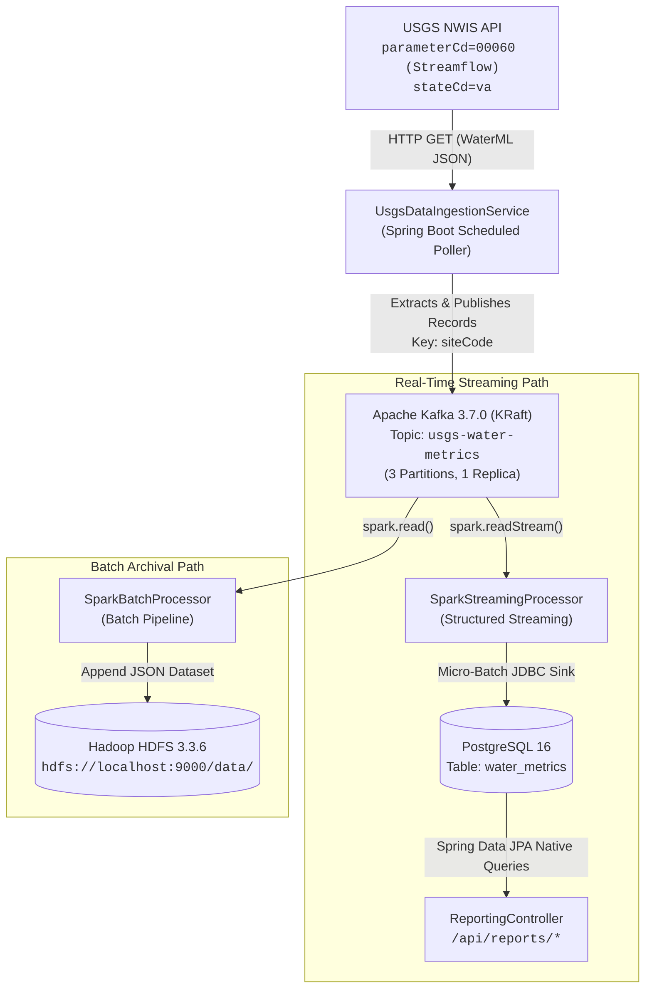

# USGS Real-Time Hydrological Data Pipeline

An end-to-end distributed data engineering platform built to ingest, stream, process, and archive real-time streamflow observation data from the **USGS National Water Information System (NWIS)** using **Apache Kafka**, **Apache Spark**, **Hadoop Distributed File System (HDFS)**, and **PostgreSQL**, orchestrated within a **Spring Boot 3** application.

---

## 1. Architecture Overview

The system captures instantaneous streamflow readings (parameter code `00060`, measured in $ft^3/s$) for Virginia river monitoring stations from the USGS NWIS REST API. The ingestion service extracts station records, publishes them to Kafka, and processes them concurrently through two paths:
1. **Real-Time Stream Processing**: Spark Structured Streaming writes micro-batches to PostgreSQL for low-latency queries and reporting APIs.
2. **Batch Archival Processing**: Spark batch jobs sync raw observation payloads from Kafka into Hadoop HDFS for big-data lake storage and historical analysis.



---

## 2. Tech Stack

| Component | Technology | Version | Description |
| :--- | :--- | :--- | :--- |
| **Application Framework** | Spring Boot | `3.2.4` | Dependency injection, scheduling, REST controllers, JPA |
| **Language Runtime** | Java OpenJDK | `17` | Standard runtime environment |
| **Streaming Broker** | Apache Kafka | `3.7.0` | KRaft mode (no ZooKeeper dependency), high-throughput log |
| **Compute Engine** | Apache Spark | `3.5.1` | Structured Streaming (Kafka &rarr; JDBC) & Batch (Kafka &rarr; HDFS) |
| **Data Lake Storage** | Apache Hadoop HDFS | `3.3.6` | Distributed block storage (NameNode & DataNode) |
| **Relational Database** | PostgreSQL | `16-alpine` | Persistent transactional store for real-time reporting |
| **Container Engine** | Docker Compose / Colima | Latest | Local orchestration with Apple Silicon (`arm64`) support |
| **Build Tool** | Gradle Wrapper | `8.7` | Build automation and dependency resolution |

---

## 3. Project Directory Structure

```
data-pipeline/
├── build.gradle                               # Gradle build config with Java 17 Spark JVM args
├── docker-compose.yml                         # Kafka, Hadoop (NameNode + DataNode), Postgres, Spark
├── hadoop.env                                 # Default HDFS filesystem environment variables
├── settings.gradle                            # Project settings
├── ANTIGRAVITY.md                             # AI context & development guidelines
├── data-pipeline-checks.md                    # Detailed verification cheat-sheet for Kafka & Hadoop
├── src/
│   ├── main/
│   │   ├── java/com/pipeline/
│   │   │   ├── DataPipelineApplication.java   # Spring Boot main class (@EnableScheduling)
│   │   │   ├── config/
│   │   │   │   └── KafkaConfig.java           # Kafka topic declaration bean (3 partitions)
│   │   │   ├── ingestion/
│   │   │   │   └── UsgsDataIngestionService.java # Scheduled poller & USGS WaterML JSON parser
│   │   │   ├── model/
│   │   │   │   └── WaterMetric.java           # JPA Entity for water_metrics table
│   │   │   ├── processing/
│   │   │   │   └── SparkBatchProcessor.java   # Batch sync job: Kafka -> Hadoop HDFS
│   │   │   ├── reporting/
│   │   │   │   ├── ReportingController.java   # REST API endpoints for metrics & triggers
│   │   │   │   └── WaterMetricRepository.java # JPA Repository with native SQL queries
│   │   │   └── service/
│   │   │       └── SparkStreamingProcessor.java # Structured Streaming job: Kafka -> PostgreSQL
│   │   └── resources/
│   │       └── application.yml                # Database, Kafka, and server configuration
│   └── test/
│       └── java/com/pipeline/
│           ├── ingestion/
│           │   └── UsgsDataIngestionServiceTest.java # Parser & nodata filter unit tests
│           └── reporting/
│               └── ReportingControllerTest.java      # REST controller unit tests
```

---

## 4. Infrastructure & Port Map

All infrastructure services run as Docker containers defined in [`docker-compose.yml`](file:///Users/jsapre/projects/data-pipeline/docker-compose.yml):

| Service | Container Name | Host Port | Internal Port | Description |
| :--- | :--- | :--- | :--- | :--- |
| **PostgreSQL** | `pipeline-postgres` | `5432` | `5432` | Database (`reporting_db`, user: `pipeline_user`) |
| **Kafka (KRaft)** | `pipeline-kafka` | `9092` | `9092` (host), `29092` (internal) | Event streaming broker |
| **HDFS NameNode** | `pipeline-namenode` | `9870`, `9000` | `9870` (Web UI), `9000` (RPC) | HDFS metadata & namespace master |
| **HDFS DataNode** | `pipeline-datanode` | `9864`, `9866`, `9867` | `9864` (HTTP), `9866` (Data Transfer) | HDFS block storage server |
| **Spark Master** | `pipeline-spark-master` | `8080`, `7077` | `8080` (Web UI), `7077` (RPC) | Spark cluster manager |
| **Spark Worker** | `pipeline-spark-worker` | dynamic | dynamic | Spark execution worker |
| **Spring Boot** | Host Process | `8081` | `8081` | Application REST API & stream coordinator |

---

## 5. Getting Started

### Prerequisites
* **macOS (Apple Silicon)** or **Linux**
* **Java 17** (`java -version`)
* **Colima** (for macOS Docker daemon) or standard **Docker Desktop / Docker Engine**

### Step 1: Start Container Infrastructure
If using Colima on macOS:
```bash
# Allocate 4 CPUs and 8GB RAM to comfortably run Spark, Hadoop, Kafka, and Postgres
colima start --cpu 4 --memory 8
```

Start the Docker containers:
```bash
docker compose up -d
```

Verify that all containers are healthy:
```bash
docker compose ps
```

### Step 2: Build and Test the Application
Run the automated test suite:
```bash
./gradlew test
```

### Step 3: Run the Spring Boot Application
Launch the pipeline:
```bash
./gradlew bootRun
```
*Note: Java 17 reflection `--add-opens` flags required by Apache Spark are automatically configured in `build.gradle` for both `bootRun` and `test`.*

Upon startup:
1. Spring Boot connects to PostgreSQL and verifies the database schema.
2. [`KafkaConfig`](file:///Users/jsapre/projects/data-pipeline/src/main/java/com/pipeline/config/KafkaConfig.java) ensures topic `usgs-water-metrics` exists.
3. [`SparkStreamingProcessor`](file:///Users/jsapre/projects/data-pipeline/src/main/java/com/pipeline/service/SparkStreamingProcessor.java) asynchronously initializes Spark Structured Streaming.
4. [`UsgsDataIngestionService`](file:///Users/jsapre/projects/data-pipeline/src/main/java/com/pipeline/ingestion/UsgsDataIngestionService.java) polls the USGS API on schedule, extracts ~274 Virginia gauging station records, and publishes them to Kafka.

---

## 6. REST API Reference

The application exposes monitoring and trigger endpoints on port `8081`:

### 1. Check Pipeline Status
```bash
curl -s http://localhost:8081/api/reports/status
```
**Example Response:**
```json
{
  "totalPostgresRecords": 2184,
  "latestRecord": {
    "id": 1938,
    "siteCode": "01673000",
    "value": 106.0,
    "timestamp": "2026-10-26T15:45:00"
  },
  "status": "UP"
}
```

### 2. Query Latest Hydrological Metrics
```bash
curl -s http://localhost:8081/api/reports/latest-water-metrics
```
**Example Response:**
```json
[
  {
    "id": 1938,
    "siteCode": "01673000",
    "value": 106.0,
    "timestamp": "2026-10-26T15:45:00"
  },
  {
    "id": 2028,
    "siteCode": "01672500",
    "value": 19.4,
    "timestamp": "2026-10-26T15:45:00"
  }
]
```

### 3. Manually Trigger USGS Ingestion
Fetches current data from USGS NWIS and publishes new observations to Kafka immediately:
```bash
curl -s -X POST http://localhost:8081/api/reports/trigger-ingest
```
**Example Response:**
```json
{
  "recordsPublished": 273,
  "status": "SUCCESS"
}
```

### 4. Trigger Batch Archival Sync to Hadoop HDFS
Reads Kafka messages from the earliest offset and appends them to HDFS (`/data/usgs_water_metrics`):
```bash
curl -s -X POST http://localhost:8081/api/reports/sync-to-hdfs
```
**Example Response:**
```json
{
  "status": "SUCCESS",
  "recordsProcessed": 1092,
  "hdfsDestination": "hdfs://localhost:9000/data/usgs_water_metrics"
}
```

---

## 7. Verification & Operational Checks

For complete step-by-step instructions, see [`data-pipeline-checks.md`](file:///Users/jsapre/projects/data-pipeline/data-pipeline-checks.md).

### Quick Kafka Inspection
```bash
# List Kafka topics
docker exec pipeline-kafka /opt/kafka/bin/kafka-topics.sh \
  --bootstrap-server localhost:9092 --list

# Read one raw JSON message from Kafka
docker exec pipeline-kafka /opt/kafka/bin/kafka-console-consumer.sh \
  --bootstrap-server localhost:9092 \
  --topic usgs-water-metrics --from-beginning --max-messages 1
```

### Quick Hadoop HDFS Inspection
```bash
# Open NameNode Web UI in your browser:
open http://localhost:9870

# Check HDFS storage capacity & live DataNodes from CLI:
docker exec pipeline-namenode /opt/hadoop/bin/hdfs dfsadmin -report

# List directories and batch files in HDFS:
docker exec pipeline-namenode /opt/hadoop/bin/hdfs dfs -ls -R /data
```

---

## 8. Key Engineering Solutions & Architecture Decisions

1. **USGS WaterML 2.0 Flattening**:
   The raw USGS payload is a single nested ~400 KB JSON document containing ~274 stations (`value.timeSeries[]`). The ingestion service unpacks this structure into discrete station events keyed by `siteCode` and excludes USGS sentinel missing-data values (`-999999.0`).
2. **Hibernate 6 vs. Spark ANTLR Classpath Compatibility**:
   Spark 3.5.1 bundles ANTLR 4.8 for SQL Catalyst parsing, whereas Hibernate 6 (Spring Boot 3) uses ANTLR 4.13 for HQL parsing. To resolve this runtime conflict, [`WaterMetricRepository`](file:///Users/jsapre/projects/data-pipeline/src/main/java/com/pipeline/reporting/WaterMetricRepository.java) executes `nativeQuery = true`, allowing Spark and Hibernate to operate together without bytecode/lexer exceptions.
3. **Container-to-Host HDFS Communication**:
   HDFS clients communicate with the NameNode on port `9000` to initiate file creation, but negotiate data blocks directly with DataNodes. Both `pipeline-namenode` and `pipeline-datanode` are configured with `dfs.client.use.datanode.hostname = true`, and DataNode ports (`9864`, `9866`, `9867`) are exposed to the macOS host.
4. **Dual Kafka Listeners**:
   Configured with `PLAINTEXT://kafka:29092` for internal inter-container communication and `PLAINTEXT_HOST://localhost:9092` for the host Spring Boot application.
5. **Non-Blocking Spark Initialization**:
   `SparkStreamingProcessor` initializes asynchronously in a background `CompletableFuture` to guarantee that the Spring Boot web application boots instantly even if Kafka or PostgreSQL takes time to warm up.

---

## 9. License

This project is open-source and available under the [MIT License](LICENSE).
